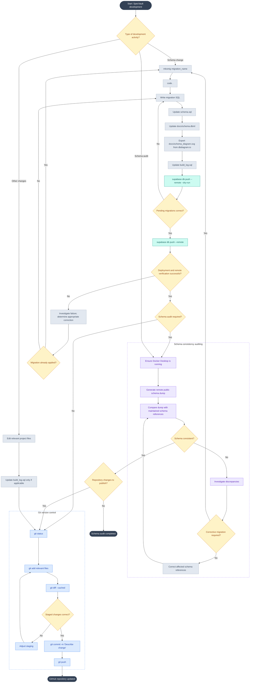

# Database Development Workflow

This document describes how database changes are developed, deployed to Supabase, audited for schema consistency, documented, and version-controlled in SpecVault. It is intended as a repeatable developer reference, not a record of individual changes.

> **Scope:** This workflow covers database schema migrations, schema consistency auditing and ordinary repository updates. Initial collection-data imports and ongoing item entry are separate workflows. Private collection data and credentials must not be committed to the public repository.


## Prerequisites

The following tools and configurations support this workflow:

| Tool or requirement | Purpose |
| --- | --- |
| Git and Git Bash | Version control, command-line operations, and custom development functions. |
| Supabase CLI | Migration creation, deployment, remote database operations, and schema dump generation. |
| Supabase authentication and project linking | Access to the intended remote Supabase project through the CLI. |
| Visual Studio Code | Editing migration files, schema references, and project documentation. |
| Docker Desktop | Container engine required for schema dump generation and local Supabase development. |
| dbdiagram.io | Visualization of the DBML schema and SVG diagram generation. |

Docker Desktop must be running when generating schema dumps. Starting a local Supabase instance or installing a separate local PostgreSQL server is not required for remote schema auditing.

PostgreSQL client tools may optionally be installed for additional database inspection and administration.

Installation instructions, environment configuration, and custom development functions will be documented in the planned [Development Environment Setup](development-setup.md) guide.

Unless otherwise specified, execute the commands in this document from the repository root.


## Workflow diagram





## Files and responsibilities

| File or directory | Role |
| --- | --- |
| `supabase/migrations/` | Ordered SQL migrations applied through the Supabase CLI; deployment history is tracked by Supabase. |
| `schema.sql` | Human-readable snapshot/reference of the intended current schema. Keep consistent with applied migrations. |
| `supabase/schema_dump.sql` | Generated SQL snapshot of the remote `public` schema, used for schema consistency auditing. Local-only artifact excluded from version control. |
| [`schema.dbml`](schema.dbml) | DBML representation of the database structure for visualization. |
| [`schema_diagram.svg`](schema_diagram.svg) | Exported database diagram for readers of the repository. |
| `build_log.sql` | Project-maintained development log; update according to the project's logging convention. It is not a replacement for migration history. |

**Source of truth:** Migrations determine how schema changes are deployed. The remote database represents the actual deployed state, while the generated schema dump provides a point-in-time representation of its structure within the selected schema. The maintained SQL snapshot and diagrams document the intended structure; they should not be treated as separate deployment mechanisms.


## Procedure: schema changes

1. **Create a migration.** New database migrations are created using `mksmig`, a custom Git Bash function that simplifies the migration creation process.

    The function serves as a local development convenience and is not a built-in Supabase CLI command.

    ```bash
    mksmig migration_name
    ```

    The function's implementation, configuration, and usage will be documented in the planned [Development Environment Setup](development-setup.md) guide.

    Alternatively, migrations can be created using the standard Supabase CLI:

    ```bash
    supabase migration new migration_name
    ```

2. **Edit the SQL.** Open the repository with `code .` and write the migration. Review dependencies, constraints, and effects on existing records.

3. **Synchronize reference files.** Update `schema.sql`, `docs/schema.dbml`, and the exported `docs/schema_diagram.svg` to reflect the intended schema after the migration. Update `build_log.sql` following the project's convention.

4. **Review pending migrations.** Run 

    ```
    `supabase db push --remote --dry-run`
    ```

    Confirm the expected migration files are listed. This previews what would be pushed; it does not validate every SQL statement or guarantee a successful deployment.

5. **Deploy.** Run 
    
    ```
    `supabase db push --remote`
    ```
    
    Check the CLI result and verify the affected tables, columns, constraints, or policies in the remote database.

6. **Handle failures carefully.** If deployment fails, inspect the error and remote migration state before retrying. 

    If a migration has already been applied remotely, do not rewrite its history; make a new corrective migration instead. 

    Consider data backups and destructive-change risks before deployment.

7. **Commit and publish.** Follow the Git steps below after verifying that the intended changes are correct.

> **Local testing:** A dry run is not a substitute for applying migrations to a disposable/local development database. For complex or destructive changes, test there before deploying to a database containing personal data.


## Procedure: schema consistency auditing

Schema consistency auditing verifies that the actual deployed database structure remains aligned with the project's migration history and maintained schema references.

An audit can be performed independently of a database migration. It does not require modifying or redeploying the remote database.

### When to perform an audit

Schema consistency audits are particularly useful:

- After significant or complex schema migrations.
- After a series of related migrations.
- When discrepancies between the remote database and maintained schema references are suspected.
- After unexpected database behavior or migration failures.
- Before significant development milestones.
- Periodically as part of database maintenance.

### Generate the remote schema dump

Before generating the schema dump, ensure that:

- The Supabase CLI is installed and authenticated.
- The local repository is linked to the intended Supabase project.
- Docker Desktop is running and its container engine is available.

From the repository root, execute:

```bash
supabase db dump --remote --schema public -f supabase/schema_dump.sql
```

This command retrieves the structure of the remote `public` schema and writes it to:

```text
supabase/schema_dump.sql
```

The dump is schema-only by default and does not export collection records. It is scoped to the `public` schema and should not be interpreted as a complete export of all Supabase-managed schemas or project configuration.

Regenerate the dump before each audit to ensure that it represents the current remote database state.

### Compare schema definitions

Compare the generated `supabase/schema_dump.sql` with the maintained `schema.sql` and, where applicable, the migration history and DBML representation.

The comparison should account for:

- Tables and columns.
- Data types and nullability.
- Default values.
- Primary and foreign keys.
- Unique and check constraints.
- Indexes.
- Functions and triggers.
- Row-level security configuration and policies.
- Other relevant database objects and dependencies.

The objective is **structural and semantic consistency rather than textual equality**.

Generated SQL may differ from the maintained schema reference in formatting, statement ordering, schema qualification, constraint declaration syntax, and PostgreSQL-generated statements. These differences do not necessarily indicate an inconsistency.

The DBML representation and exported SVG diagram should also be checked for consistency within the scope of the database structures they represent.

### Resolve discrepancies

If an inconsistency is identified, determine its origin before making changes.

- If the remote schema is correct but a maintained reference is outdated, correct the affected reference files.
- If the remote schema differs from the intended structure, investigate the migration history and prepare a corrective migration when necessary.
- If the apparent discrepancy is only a difference in SQL representation, no corrective change is required.

Do not automatically replace `schema.sql` with the generated schema dump or execute the dump against the remote database as a means of synchronization.

If a corrective migration is required, return to the schema development procedure. After deploying the correction, regenerate the schema dump and repeat the audit before proceeding to version control.

### Manage generated schema dumps

The generated schema dump is a temporary development and auditing artifact, not a maintained project source file.

The repository's root `.gitignore` must exclude it using:

```gitignore
# Supabase local state and generated artifacts
/supabase/schema_dump.sql
```

The file may be regenerated, overwritten, or removed as needed. It must not be committed to the public repository.

If an audit results in changes to maintained schema references or corrective migrations, commit those changes through the normal Git workflow.

An audit that identifies no discrepancies and produces no version-controlled changes does not require a Git commit.

Significant findings, corrective actions, or exceptional decisions may be recorded in `build_log.sql`, GitHub Issues, or other appropriate project records.


## Procedure: other repository changes

For changes that do not modify the database schema (such as documentation, application code, or configuration), edit only the relevant files. Update `build_log.sql` only when the change belongs in that log. Do not create an empty database migration or run `supabase db push` for unrelated changes.

## Git review and publication

From the repository root:

```bash
git status
git add <relevant-files>
git diff --cached
git commit -m "Describe change"
git push
```

Review staged files before committing. Confirm that private seed files, real collection records, credentials, environment files, and other secrets are excluded. If the staged content is incorrect, adjust staging and review again. 

`git push` updates the GitHub repository; it does not deploy database migrations.

## Operational conventions

- Keep migration files in version control and apply them in order.
- Do not rewrite migrations that have already been applied remotely.
- Keep the SQL snapshot, DBML source, and exported SVG aligned with the deployed schema.
- Use generated remote schema dumps to audit schema consistency, not as independently maintained schema definitions or deployment mechanisms.
- Regenerate schema dumps before performing consistency audits.
- Exclude generated schema dumps from version control.
- Investigate schema discrepancies before modifying the database or maintained references.
- Treat `build_log.sql` as a project record, not as an executable migration or proof of remote deployment.
- Use only demonstration/synthetic seed data in the public repository. Maintain actual collection-data import files privately.
- Record exceptional decisions, incidents, or significant changes in GitHub Issues or other project records; keep this document focused on the repeatable procedure.
- Revisit this workflow if the project later adopts automated tests, automated schema consistency checks, CI-based migrations, or additional deployment environments.

## Related documentation

- [Project README](https://github.com/AlejandroPenaloza/SpecVault/blob/main/README.md)
- [Development Environment Setup](development-setup.md) *(planned)*
