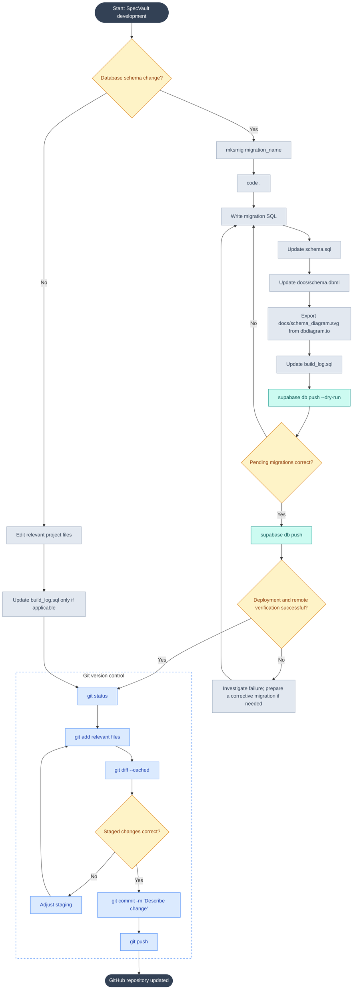

# Database Development Workflow

This document describes how database changes are developed, deployed to Supabase, documented, and version-controlled in SpecVault. It is intended as a repeatable developer reference, not a record of individual changes.

> **Scope:** This workflow covers database schema migrations and ordinary repository updates. Initial collection-data imports and ongoing item entry are separate workflows. Private collection data and credentials must not be committed to the public repository.

## Workflow diagram



## Files and responsibilities

| File or directory                          | Role                                                                                                                                     |
| ------------------------------------------ | ---------------------------------------------------------------------------------------------------------------------------------------- |
| `supabase/migrations/`                     | Ordered SQL migrations applied through the Supabase CLI; deployment history is tracked by Supabase.                                      |
| `schema.sql`                               | Human-readable snapshot/reference of the intended current schema. Keep consistent with applied migrations.                               |
| [`schema.dbml`](schema.dbml)               | DBML representation of the database structure for visualization.                                                                         |
| [`schema_diagram.svg`](schema_diagram.svg) | Exported database diagram for readers of the repository.                                                                                 |
| `build_log.sql`                            | Project-maintained development log; update according to the project's logging convention. It is not a replacement for migration history. |

**Source of truth:** Migrations determine how schema changes are deployed. The schema snapshot and diagrams document the resulting structure; they should not be treated as separate deployment mechanisms.

## Procedure: schema changes

1. **Create a migration.** New database migrations are created using `mksmig`, a custom Git Bash function that simplifies the migration creation process.

The function serves as a local development convenience and is not a built-in Supabase CLI command.

```bash
mksmig migration_name
```

The function's implementation, configuration, and usage will be documented in the planned [Development Environment Setup](development-setup.md) guide.

Alternatively, migrations can be created using the standard Supabase CLI:

```bash
supabase migration new migration_name
```

2. **Edit the SQL.** Open the repository with `code .` and write the migration. Review dependencies, constraints, and effects on existing records.
3. **Synchronize reference files.** Update `schema.sql`, `docs/schema.dbml`, and the exported `docs/schema_diagram.svg` to reflect the intended schema after the migration. Update `build_log.sql` following the project's convention.
4. **Review pending migrations.** Run `supabase db push --dry-run` and confirm the expected migration files are listed. This previews what would be pushed; it does **not** validate every SQL statement or guarantee a successful deployment.
5. **Deploy.** Run `supabase db push` against the intended Supabase project. Check the CLI result and verify the affected tables, columns, constraints, or policies in the remote database.
6. **Handle failures carefully.** If deployment fails, inspect the error and remote migration state before retrying. If a migration has already been applied remotely, do not rewrite its history; make a new corrective migration instead. Consider data backups and destructive-change risks before deployment.
7. **Commit and publish.** Follow the Git steps below after verifying that the intended changes are correct.

> **Local testing:** A dry run is not a substitute for applying migrations to a disposable/local development database. For complex or destructive changes, test there before deploying to a database containing personal data.

## Procedure: other repository changes

For changes that do not modify the database schema (such as documentation, application code, or configuration), edit only the relevant files. Update `build_log.sql` only when the change belongs in that log. Do not create an empty database migration or run `supabase db push` for unrelated changes.

## Git review and publication

From the repository root:

```bash
git status
git add <relevant-files>
git diff --cached
git commit -m "Describe change"
git push
```

Review staged files before committing. Confirm that private seed files, real collection records, credentials, environment files, and other secrets are excluded. If the staged content is incorrect, adjust staging and review again. `git push` updates the GitHub repository; it does not deploy database migrations.

## Operational conventions

- Keep migration files in version control and apply them in order.
- Keep the SQL snapshot, DBML source, and exported SVG aligned with the deployed schema.
- Treat `build_log.sql` as a project record, not as an executable migration or proof of remote deployment.
- Use only demonstration/synthetic seed data in the public repository. Maintain actual collection-data import files privately.
- Record exceptional decisions, incidents, or significant changes in GitHub Issues or other project records; keep this document focused on the repeatable procedure.
- Revisit this workflow if the project later adopts automated tests, CI-based migrations, or additional deployment environments.

## Related documentation

- [Project README](https://github.com/AlejandroPenaloza/SpecVault/blob/main/README.md)
